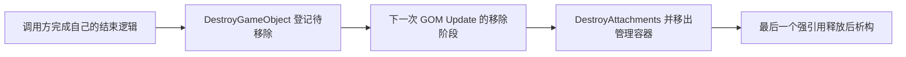

# 对象生命周期与所有权：如何使用

[返回系统阅读地图](README.md) · [项目指南](../agent-guide/PROJECT_GUIDE.md)

本页说明创建、启动、停用、移除与引用失效之间的关系。架构选型与完整附件规则仍由[架构与资源契约](../agent-guide/ARCHITECTURE_AND_RESOURCES.md#架构决策继承式玩法对象)维护，函数签名以头文件为准。

## 先区分三件事

**内存存在、仍被场景管理、还能参与玩法，是三个不同条件。**

- `shared_ptr` 能延长对象内存寿命，但不能保证它还属于当前场景、仍活动或附件仍存在。
- `IsActive()` 只是活动标志。`SetActive(false)` 不会将对象从管理容器移除，也不会自动执行派生类的结束逻辑。
- 稳定实体 ID 用于在当前 Board 的注册表中重新查找对象，不是跨场景通用的永久句柄。

主要入口：[GameObject.h](../../PlantVsZombies/Game/GameObject.h)、[GameObjectManager.h](../../PlantVsZombies/Game/GameObjectManager.h)、[EntityRegistry.h](../../PlantVsZombies/Game/EntityRegistry.h)。下文将 GameObjectManager 简称为 GOM。

## 创建：什么时候会 Start

| GOM 接口 | 返回值 | 加入位置与启动时机 |
|---|---|---|
| `CreateGameObject<T>` | 非拥有的 `T*` | 先放待加入队列，GOM 处理该队列时调用 `Start()` |
| `CreateGameObjectAsShared<T>` | `shared_ptr<T>` | 同样延迟启动，允许调用方登记弱引用或明确共享所有权 |
| `CreateGameObjectImmediate<T>` | 非拥有的 `T*` | 直接放活动容器，返回前调用 `Start()` |
| `CreateGameObjectImmediateAsShared<T>` | `shared_ptr<T>` | 同样立即启动，并返回强引用 |

四种接口都先构造对象并分配绘制顺序。延迟创建返回时可以配置对象，但不能假定 `HasStarted()` 已为 true；在 GOM 的对象更新阶段创建的延迟对象，要等下一次待加入阶段才启动。`Immediate` 会直接修改正在管理的容器，不应为了“快一点”替换普通创建，尤其不要从 worker 更新阶段调用。

[GameObject::Start](../../PlantVsZombies/Game/GameObject.cpp) 负责注册 Collider 并置启动标志。派生类若覆写 Start，应核对自己是否保留基类初始化；不要在调用方额外手动 Start 来掩盖错误的创建路径。Clickable 虽在创建时登记输入表，[输入分发](../../PlantVsZombies/Game/ClickableComponent.cpp)仍会跳过尚未启动或已失活的宿主。

对于已有玩法类型，优先使用其 Board／工厂入口，确保类型自己的注册与状态初始化一并执行。上述表格解释底层机制，不替代各类型的正式创建流程。

## 当前代码中的最小所有权示例

下面摘自 [Board::CreateShovel](../../PlantVsZombies/Game/Board/Board.cpp)，省略函数签名与前置的重复创建检查；`this` 是 Board：

```cpp
auto shovel = GameObjectManager::GetInstance()
    .CreateGameObjectImmediateAsShared<Shovel>(LAYER_UI, this);
mShovel = shovel;
return mShovel;
```

这里 GOM 持有强引用，`Board::mShovel` 是 `weak_ptr<Shovel>`。局部变量退出后，铲子仍由 GOM 管理。使用时如同 `Board::ActivateShovel`，先 `mShovel.lock()`，并在该次操作期间持有得到的强引用。这个例子的立即启动是既有调用选择，不代表所有对象都应立即启动。

不要从返回的裸指针重新构造 `shared_ptr`，那会产生第二个独立控制块。需要强引用时直接使用已有的 Shared 创建入口；仅观察对象时保留弱引用或实体 ID。

## 停用、请求移除和真正释放

普通单对象移除在 [GOM 实现](../../PlantVsZombies/Game/GameObjectManager.cpp)中分两步：



`DestroyGameObject()` 当场回收绘制序号并把对象放入待移除队列；**它不自动调用 `SetActive(false)`，也不调用类型的 Die 等玩法结束接口。** 若本次结束要求立即停止活动，应由对象自己的正式结束流程处理停用、计数、关联和副作用，再登记移除，并防止重复提交。调用后当前函数也不会自动 return。

到移除阶段，GOM 先销毁显式附件，再撤销自己的容器引用。外部即使还持有 `shared_ptr`，`GetCollider()`、`GetClickable()`、`GetShadow()` 也可能已为空。`DestroyAttachments()` 不会重置 Transform 或所有派生字段，因此对象内存尚可访问不能当作“仍可恢复运行”的依据。

两个重载还有不同边界：

- 裸指针重载先在线性扫描中寻找现有对象或待加入对象；找不到只记录警告，不会替调用方 delete。只能传仍有效且确由 GOM 创建的指针。
- Shared 重载直接登记传入对象，不替调用方证明它属于 GOM，也没有通用的重复请求保护。

**Start 前的 Destroy 会取消延迟创建。** 移除阶段同时从活动容器和待加入队列擦除对象；较早对象的 Start 若取消队列中后续对象，后者也不会启动，其附件由下一次移除阶段清理。取消不要求先设置活动标志；外部强引用仍遵守上述内存寿命规则。

## 跨对象引用：每次行动前重新确认

[EntityRegistry.cpp](../../PlantVsZombies/Game/EntityRegistry.cpp)中的普通 `GetPlant/GetZombie/GetBullet/GetCoin/GetMower` 查询通过弱引用取得对象，返回的是裸指针，不把临时强引用交给调用方，也不统一检查活动或玩法资格。

| 需要保存的关系 | 使用方式 |
|---|---|
| 当前 Board 内跨帧、需要入档的实体关系 | 保存对应实体类型的 ID；动作前重新查询并检查该动作的资格 |
| 不入档、可能提前消失的观察关系 | 保存 `weak_ptr`，使用时 lock；还要检查对象是否仍活动及所属场景是否有效 |
| 生命周期明确包在宿主以内的短期访问 | 非拥有裸指针；不跨移除、替换附件或场景切换边界缓存 |
| 确实需要共同拥有的对象 | 使用既有 `shared_ptr`，明确何时释放；不能只为避免判空而延长所有权 |

ID 按实体类别分别计数，不能把一个类别的整数拿到另一类别查询。`Add*WithID` 是恢复指定 ID 的入口；仅登记弱引用不会把对象加入 GOM，也不会让它自动 Start。查询非空之后仍需检查活动、存活、阵营等当前操作要求，不能把注册表中的存在当成目标资格。

一次动作可能触发对方的生命周期变化。跨回调、下一帧或读档重建后，重新解析 ID 和可选附件；不要把上一次取得的地址当成同 ID 永远对应同一实例。

## 更新与绘制的顺序

GOM 的拥有容器保持对象加入顺序；绘制使用单独的非拥有排序视图，修改层号、行深度或执行 Draw 不得改变玩法更新顺序。`GetAllGameObjects()` 返回加入顺序，调用者若需要某种排序须显式建立视图。

每步处理待移除和待加入对象后，固定本步活动对象集合，依次执行：本地 `UpdateParallel` 预推进 → 主线程按对象顺序提交 deferred 操作 → 活动对象 `Update`。小场景也走同样三个阶段，只把预推进放在主线程；worker 完成先后不得决定事件顺序。阶段中立即创建或从对象池激活的对象从下一步开始参与更新，仍可在本帧绘制或碰撞。事件执行前必须确认宿主仍活动且激活代号未变，因此较早事件杀死宿主后，其剩余事件被丢弃；重新激活还会递增不入档的代号，使旧周期的回调及更新快照失效。这不替代稳定实体 ID。延迟创建继续遵守原有 Start 边界。

`smoke_framework_pipeline` 在真实主循环验证串行/worker 命中、预推进屏障、交换绘制顺序后的玩法顺序、失活/复用后旧事件丢弃，以及 Start 前取消不启动且释放管理器所有权；它不注册新的 Animator 帧事件。

## 场景切换与线程边界

[SceneManager::SwitchTo](../../PlantVsZombies/Game/SceneManager.cpp) 对已注册目标依次执行旧场景 OnExit、销毁旧场景、构造新场景、调用新场景 OnEnter，最后才设置 `currentScene_`。因此在新场景 OnEnter 内不要假定 `GetCurrentScene()` 已指向自己。目标未注册时返回失败，旧场景保留。

[Scene::OnExit](../../PlantVsZombies/Game/Scene.h) 会清理 UI、粒子与全部 GOM 对象。[GameScene::OnExit](../../PlantVsZombies/Game/GameScene.cpp)在调用它之后才释放 Board。外部强引用若继续保留旧对象，也不会延长旧 Board 的生命；旧对象中的 Board 裸指针不能在切换后使用。覆盖式界面和纯 UI 的所有权见[场景边界](../agent-guide/ARCHITECTURE_AND_RESOURCES.md#所有权与场景边界)。

创建／移除队列没有通用并发写入保护。`UpdateParallel()` 只做对象本地工作，把需要串行执行的操作放入 deferred buffer；GOM 等 worker 结束后在主线程回放，再执行普通 Update。不要把持有 `shared_ptr` 误当作对象字段或容器的线程安全保证。

## 改动这些入口时如何验证

本页不另建一套验收规则，运行方式与证据要求见 [AutoTest 验证](../agent-guide/AUTOTEST.md)。按改动覆盖：

- 延迟与立即创建的 Start 时机，以及 Start 前不可点击。
- 已启动对象的停止活动、一次性移除，以及外部强引用仍存在时附件已注销。
- 同场景关联目标消失、场景退出与重进、读档后重新解析 ID。
- 涉及并行更新时，分别覆盖串行与实际命中 worker 的路径。

已有 [smoke_zombie_row_index_lifetime.json](../../autotest/scripts/smoke_zombie_row_index_lifetime.json)可定位“生命周期边沿之后索引不能留下旧地址”的专项，但它不等于覆盖了本页全部契约。
